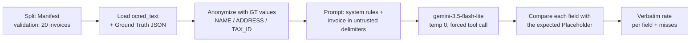

# Experiment: does Gemini preserve Placeholders on anonymized invoices?

Ticket: #18 (map: #1), decision it validates: #17. Date: 2026-10-31.

## Question

The pipeline anonymizes sensitive invoice values before the model sees the text and
swaps them back afterwards (**Restore**, an exact-string substitution). That only
works if the model copies each **Placeholder** into the right field of its
**Extraction** untouched. Does `gemini-3.5-flash-lite` do that for the default
`[TYPE_n]` format, and if not, which fallback format should we adopt?

## Result

| Run | Format | Placeholders | Returned verbatim | Rate |
|---|---|---|---|---|
| Baseline | `[TYPE_n]` | 140 (20 invoices x 7 fields) | 140 | **100%** |
| Control (shuffled indices) | `[TYPE_n]` | 140 | 140 | **100%** |

Per field, both runs: 20/20 for `seller.name`, `seller.address`, `seller.tax_id`,
`seller.gstin`, `client.name`, `client.address`, `client.tax_id`. Zero misses, so the
fallback formats (`<<TYPE_n>>`, bare `TYPE_n`) and plan B (anonymize only tax id, email,
phone, account) were not needed. **Decision: keep `[TYPE_n]`.**

Raw results: [`data/placeholder_test_results.json`](../../data/placeholder_test_results.json)
(baseline) and
[`data/placeholder_test_results_shuffled.json`](../../data/placeholder_test_results_shuffled.json)
(control; its `shuffled_indices` flag is `true`, the baseline file predates the flag).

## Evaluation flow



1. **Fixed set.** The 20 invoices of the Validation Set come from the committed
   [Split Manifest](../../data/split_manifest.json) (seed 42, 60/20/20, stratified by
   line-item count), so the run is reproducible and never touches the Test Set.
2. **Anonymize with Ground Truth.** Seller and client name, address and tax id are
   replaced using the Ground Truth values, one Placeholder per distinct value (the
   seller `tax_id` and `gstin` are the same value and share one). The test targets the
   *model*, so detector recall (Presidio, #17) is deliberately out of the loop.
3. **Extract through a forced tool call.** One `record_invoice` function whose JSON
   Schema has the header, seller, client and total; `tool_config` mode `ANY`, temperature
   0. The system prompt marks the invoice as untrusted data and asks for identifiers to
   be copied exactly. Free text is never accepted, only the tool arguments.
4. **Score.** A field counts as verbatim only on exact string equality with the expected
   Placeholder (no trimming, no fuzzy match), mirroring the strictness of Restore.
5. **Rate limit.** One call every 4.5 s (under the 15 RPM free-tier limit from #14) and
   exponential backoff on 429/500/503.

Reproduce (needs `GEMINI_API_KEY` in a git-ignored `.env` and the Kaggle data in
`data/kaggle/`):

```bash
uv run python scripts/placeholder_preservation_test.py            # all formats
uv run python scripts/placeholder_preservation_test.py bracket    # default only
uv run python scripts/placeholder_preservation_test.py --shuffle bracket   # control
```

## Why the control run

In the baseline, indices follow order of appearance, so every invoice carries the same
tokens (`[NAME_1]`, `[NAME_2]`, ...). A model could pass by memorising them rather than
copying. The control offsets the indices per invoice (seeded by the invoice number), so
a token is never repeated across documents. It also passed 140/140, which supports copying
over memorisation.

## Limits (state these in the spec and README)

- One template, synthetic data, one model, temperature 0, 20 invoices.
- Email, phone and bank account do not exist in this dataset: untested.
- The detector is bypassed (Ground Truth anonymization), and each address is one
  Placeholder placed on the street line with the city line dropped, simpler than what the
  real pipeline will produce.
- A real fault would show up as a Restore failure feeding the repair loop (#17), so the
  pipeline stays safe even if this result stops holding for another model or template.
- Using free-tier data for tests is acceptable because the data is synthetic (#3).
